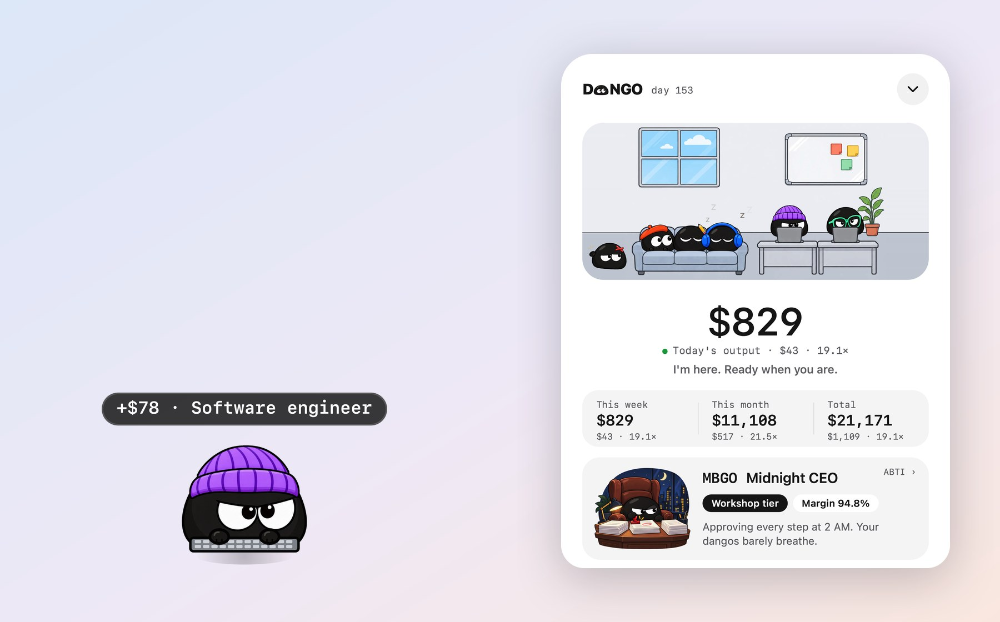
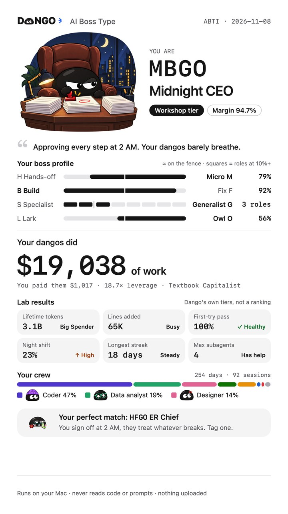
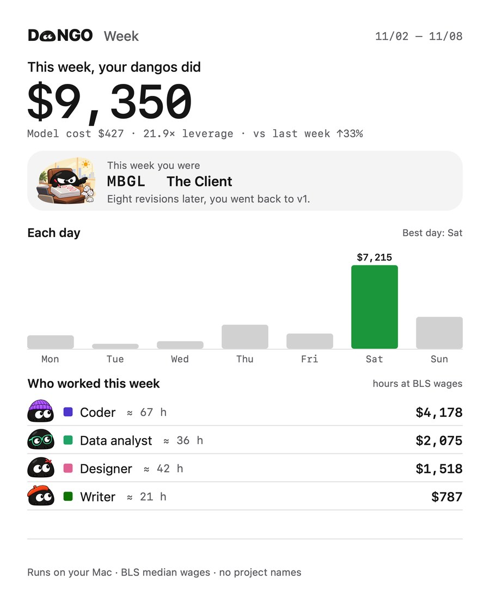

<p align="center">
  <picture>
    <source media="(prefers-color-scheme: dark)" srcset="docs/images/logo-dark.png">
    
  </picture>
</p>

<h3 align="center">Tu IA trabaja para ti. Ahora puedes verlo.</h3>

<p align="center">DANGO pone precio a cada paso de tu IA: lo que cobraría una persona por hacer el mismo trabajo.</p>

<p align="center">
  <a href="README.md">中文</a> · <a href="README.en.md">English</a> · <a href="README.ko.md">한국어</a> · <a href="README.ja.md">日本語</a> · <a href="README.fr.md">Français</a> · <b>Español</b>
</p>

<p align="center">
  <a href="https://dangoai.org/en/"><b>dangoai.org</b></a> · <a href="#instalar">Instalar</a> · <a href="https://dangoai.org/en/how/">Cómo se calcula</a> · <a href="docs/DEVELOPMENT.md">Desarrollo</a>
</p>

<p align="center"><sub>Gratis · macOS 13 o posterior · Apple silicon e Intel · todo se calcula en tu Mac</sub></p>

<p align="center">
  
</p>

## Tu factura dice cuánto costó. No cuánto vale.

Cada día le pasas trabajo a Claude Code, Codex y compañía: código, hojas de cálculo, edición de video, investigación. La factura de tokens te dice cuánto gastaste. Nada te dice cuánto trabajo hicieron realmente por ti.

| Factura de modelos | Trabajo de tus dangos | Apalancamiento |
| :---: | :---: | :---: |
| **$998** | **$18,588** | **18.6×** |
| Tokens que entran, dinero que sale. | Lo que pagarías a personas por el mismo trabajo. | Cuánto trabajo compra cada dólar en modelos. |

<sub>Datos de ejemplo. Tus propios números aparecen al instalarlo.</sub>

## ¿A quién contratarías para esto?

En cada paso de tu IA, DANGO se pregunta: ¿a quién contratarías para hacerlo? El código va a un **ingeniero de software**, los gráficos a un **analista de datos**, la barriga del gato a un **médico**. Luego estima cuánto tardaría una persona y aplica el salario por hora de ese oficio.

| Qué hizo la IA | A quién contratar | Cuánto tarda una persona | Salario |
| --- | --- | --- | ---: |
| Cambió 120 líneas de código | Ingeniero de software · $65.38/h | unos 23 min | $25.06 |
| Ejecutó un script que dibuja un gráfico | Analista de datos · $57.80/h | 4 min | $3.85 |
| Preguntó por qué el gato tiene diarrea | Médico · $117.39/h | una consulta de 15 min | $29.35 |

## 20 oficios, pagados al salario mediano real de EE. UU.

Los salarios por hora vienen del **Bureau of Labor Statistics** de EE. UU. (OEWS, mayo de 2025): solo el sueldo, sin prestaciones. Sin topes ni descuentos.

<p align="center"></p>

| Oficio | Por hora | Oficio | Por hora |
| --- | ---: | --- | ---: |
| Médico | $117.39 | Desarrollador front-end | $47.49 |
| Abogado | $76.76 | Científico | $46.29 |
| Ingeniero de software | $65.38 | Investigador | $37.87 |
| Analista de datos | $57.80 | Redactor | $36.98 |
| Ingeniero de QA | $50.14 | Editor de video | $36.26 |
| Analista financiero | $49.40 | Diseñador gráfico | $30.27 |
| Gerente de producto | $49.19 | Chef | $30.03 |
| Músico | $47.80 | Consejero | $28.53 |
| Arquitecto | $47.73 | Entrenador personal | $22.67 |
| Ingeniero de operaciones | $47.66 | Capturista de datos | $19.88 |

## Vive en una esquina de tu pantalla, vestido para el trabajo.

Un gorro para programar, auriculares para editar video. Al terminar cada turno, una burbuja dice lo que ganó. **Un clic y se abre toda la oficina**: quién está en su escritorio, quién espera tu aprobación, quién holgazanea en el sofá o se quedó dormido; cuánto valen hoy, esta semana, este mes y el total, con el costo de los modelos y el apalancamiento. La oficina sigue el reloj de tu Mac, del día al atardecer y a la noche, y hay un tema oscuro con dangos blancos.

<p align="center"></p>

## Cuatro agentes. Una sola oficina.

**Claude Code · Codex · DeepSeek · WorkBuddy**

Sin plugins ni configuración. DANGO lee los registros de sesión que estas herramientas ya guardan en tu Mac, cuenta tu trabajo pasado desde el momento en que lo instalas y los pone lado a lado: quién hizo más y quién te da más apalancamiento.

## Ahora eres el jefe. ¿Qué clase de jefe eres?

Sin cuestionarios. A partir de lo que tus agentes hicieron de verdad, DANGO calcula **cuatro letras, un tamaño de empresa y un margen**, y luego cuenta tu historia: tu noche más tardía, tu día más intenso, tu nómina.

<table>
<tr>
<td width="300"></td>
<td>

| Dimensión | Un lado | El otro |
| --- | --- | --- |
| Cómo repartes el trabajo | Delega **H** | Microgestiona **M** |
| Qué haces sobre todo | Construir **B** | Arreglar **F** |
| Qué tan amplio trabajas | Especialista **S** | Generalista **G** |
| Cuándo trabajas | Madrugador **L** | Noctámbulo **O** |

Cuatro dimensiones, dieciséis tipos de jefe. El tamaño de tu empresa depende del trabajo de tus dangos, en cinco niveles: Puesto propio, Taller, Estudio, Grupo, Empresa cotizada.

[Ver los 16 tipos →](https://dangoai.org/en/types/)

</td>
</tr>
</table>

## Cada informe es una tarjeta para presumir.

Día, semana, mes, año y total, **cada uno con el tipo de jefe de ese periodo**. Toca «Compartir» y elige adónde va. Las tarjetas nunca llevan nombres de proyectos, títulos de sesión ni código.

<p align="center"></p>

## Todo se calcula en tu Mac. No se sube nada.

- **Solo números**: a qué oficios fue cada turno, cuántos minutos, cuánto vale y cuánto costaron los modelos.
- **Sin guardar contenido**: un prompt se lee una vez en memoria para saber de qué trata y se descarta. Nunca se guardan código, rutas ni nombres de repositorios.
- **Nada se sube**: no abre puertos de red. Compartir una tarjeta lo decides tú.

## Instalar

El instalador llegará pronto a [dangoai.org](https://dangoai.org/en/). Por ahora puedes empaquetarlo desde el código fuente (necesitas Rust y las herramientas de línea de comandos de Xcode):

```bash
git clone https://github.com/justinz183/dango.git && cd dango
rustup target add aarch64-apple-darwin x86_64-apple-darwin
apps/widget/package.sh
```

Abre `Dango-<versión>.dmg` en `target/dist`, arrastra Dango a Aplicaciones y ábrelo. La primera vez, macOS avisa que no puede verificar al desarrollador: ve a Ajustes del Sistema → Privacidad y seguridad y pulsa «Abrir igualmente». El dango aparece en la esquina inferior derecha, lee tu historial durante unos segundos y luego cuenta la historia de tu tipo de jefe. Desde entonces lleva la cuenta en segundo plano y vuelve tras reiniciar.

La app habla chino, inglés, coreano, japonés, francés y español: haz clic derecho en el dango para elegir el idioma.

**Windows (versión preliminar)**: Windows 10 1803 o posterior de 64 bits, con WebView2 (incluido en Windows 11). Ejecuta `Dango_<versión>_x64-setup.exe`: se instala solo para ti, sin permisos de administrador, en `%LOCALAPPDATA%\Dango`. El instalador aún no está firmado; si SmartScreen lo bloquea, haz clic en Más información → Ejecutar de todas formas. El dango aparece en la esquina inferior derecha; clic izquierdo en el icono de la bandeja para abrir o cerrar el panel, clic derecho para el idioma y la apariencia. El mismo `Dango.exe` lleva la cuenta en segundo plano, se abre al iniciar sesión y guarda sus datos en `%USERPROFILE%\.dango`. Esta primera versión trae el dango de la esquina, el panel y la bandeja; la historia del tipo de jefe, la ventana de informes y las imágenes para compartir llegan después, y «Compartir hoy» copia por ahora un informe de texto. El instalador lo compila en Windows el [flujo de trabajo de Windows](.github/workflows/windows.yml).

## Desarrollo

| Carpeta | Contenido |
| --- | --- |
| `crates/core` | Lógica pura: temas, oficios y salarios, cálculo |
| `crates/daemon` | El demonio: sigue los registros de cada agente, SQLite, tipo de jefe, informes |
| `crates/cli` | El comando `dango` |
| `apps/widget` | La app de macOS (Swift / AppKit): el dango, el panel, la oficina, el tipo de jefe, las tarjetas |
| `apps/windows` | La app de Windows (Tauri v2): el dango, el panel, la bandeja; el mismo `Dango.exe --daemon` lleva la cuenta |
| `assets` | Oficios y salarios, precios de modelos, umbrales y textos del tipo de jefe |
| `site` | El sitio web dangoai.org |

Compilar, probar y empaquetar: [docs/DEVELOPMENT.md](docs/DEVELOPMENT.md). Todas las reglas de cálculo: [docs/DESIGN.md](docs/DESIGN.md).
