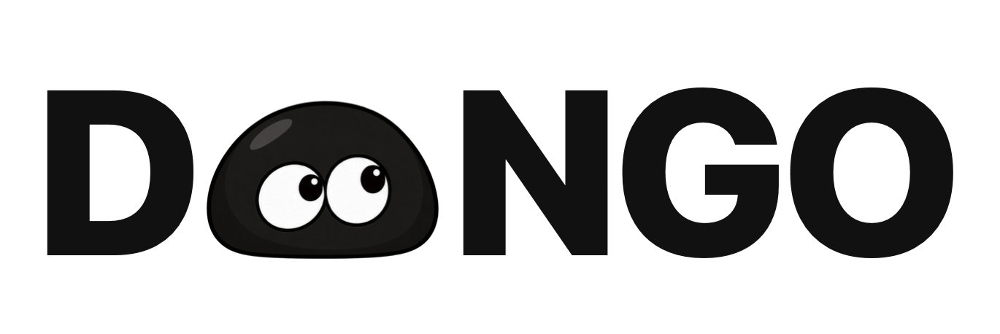
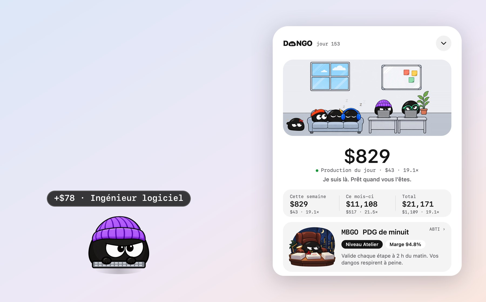
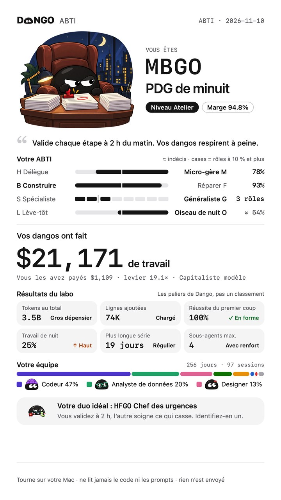
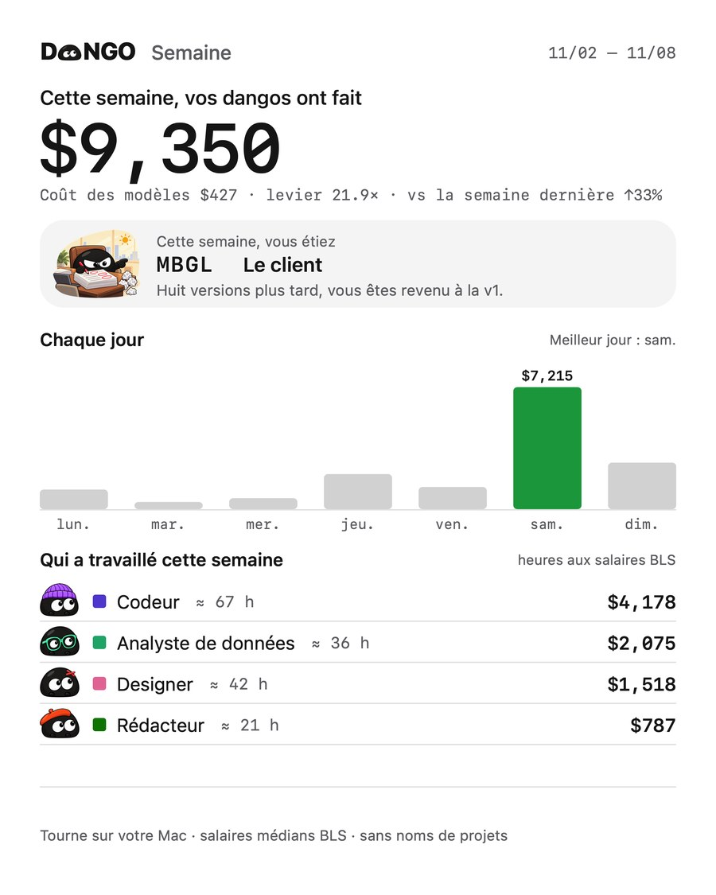

<p align="center">
  <picture>
    <source media="(prefers-color-scheme: dark)" srcset="docs/images/logo-dark.png">
    
  </picture>
</p>

<h3 align="center">Votre IA travaille pour vous. Maintenant, vous le voyez.</h3>

<p align="center">DANGO chiffre chaque étape de votre IA au salaire qu’on paierait à une personne pour faire le même travail.</p>

<p align="center"><b>DANGO est une app gratuite pour la barre des menus du Mac qui fait le compte du travail que Claude Code, Codex et d’autres outils d’IA ont fait pour vous, de ce qu’il a coûté et de ce qu’il vaut.</b></p>

<p align="center">
  <a href="README.md">English</a> · <a href="README.zh.md">中文</a> · <a href="README.ko.md">한국어</a> · <a href="README.ja.md">日本語</a> · <b>Français</b> · <a href="README.es.md">Español</a>
</p>

<p align="center">
  <a href="https://dangoai.org/fr/"><b>dangoai.org</b></a> · <a href="#installer">Installer</a> · <a href="https://dangoai.org/ai-work-value/">Le calcul</a> · <a href="docs/DEVELOPMENT.md">Développer</a>
</p>

<p align="center">
  <a href="https://github.com/justinz183/dango/releases/latest"></a>
  
  <a href="https://github.com/justinz183/dango/commits"></a>
</p>

<p align="center"><sub>Gratuit · macOS 13 ou plus récent · Apple silicon et Intel · tout est calculé sur votre Mac</sub></p>

<p align="center">
  
</p>

## Votre facture dit ce que ça coûte. Pas ce que ça vaut.

Chaque jour, vous confiez du travail à Claude Code, Codex et les autres : du code, des tableaux, du montage vidéo, des recherches. La facture de tokens vous dit combien vous avez dépensé. Rien ne vous dit combien de travail ils ont réellement fait pour vous.

| Facture des modèles | Travail fait par vos dangos | Levier |
| :---: | :---: | :---: |
| **326 $** | **4 834 $** | **14,8×** |
| Des tokens consommés, de l’argent dépensé. | Ce que vous paieriez des gens pour le même travail. | Ce que rapporte en travail chaque dollar de modèle. |

<sub>Données d’exemple. Vos propres chiffres apparaissent dès l’installation.</sub>

## À qui confieriez-vous ce travail ?

À chaque étape de votre IA, DANGO pose une question : qui embaucheriez-vous pour la faire ? Le code va à un **ingénieur logiciel**, les graphiques à un **analyste de données**, le ventre du chat à un **médecin**. Puis il estime le temps qu’il faudrait à une personne et applique le salaire horaire de ce métier.

| Ce que l’IA a fait | Qui embaucher | Temps pour une personne | Salaire |
| --- | --- | --- | ---: |
| Modifié 120 lignes de code | Ingénieur logiciel · 65,38 $/h | environ 23 min | 25,06 $ |
| Lancé un script qui trace un graphique | Analyste de données · 57,80 $/h | 4 min | 3,85 $ |
| Demandé pourquoi le chat a la diarrhée | Médecin · 117,39 $/h | une consultation de 15 min | 29,35 $ |

## 20 métiers, payés au vrai salaire médian américain.

Les salaires horaires viennent du **Bureau of Labor Statistics** des États-Unis (OEWS, mai 2025) : le salaire seul, sans avantages. Sans plafond, sans remise.

<p align="center"></p>

| Métier | Horaire | Métier | Horaire |
| --- | ---: | --- | ---: |
| Médecin | 117,39 $ | Développeur front-end | 47,49 $ |
| Avocat | 76,76 $ | Scientifique | 46,29 $ |
| Ingénieur logiciel | 65,38 $ | Chercheur | 37,87 $ |
| Analyste de données | 57,80 $ | Rédacteur | 36,98 $ |
| Ingénieur QA | 50,14 $ | Monteur vidéo | 36,26 $ |
| Analyste financier | 49,40 $ | Graphiste | 30,27 $ |
| Chef de produit | 49,19 $ | Chef cuisinier | 30,03 $ |
| Musicien | 47,80 $ | Conseiller | 28,53 $ |
| Architecte | 47,73 $ | Coach sportif | 22,67 $ |
| Ingénieur d’exploitation | 47,66 $ | Opérateur de saisie | 19,88 $ |

## Il vit dans un coin de votre écran, habillé pour le travail.

Un bonnet pour le code, un casque pour la vidéo. À la fin de chaque tour, une petite bulle dit ce qu’il a rapporté. **Un clic, et tout le bureau s’ouvre** : qui est à son poste, qui attend votre feu vert, qui flemmarde sur le canapé ou s’est endormi ; ce que valent aujourd’hui, cette semaine, ce mois et le total, avec le coût des modèles et le levier. Le bureau suit l’horloge de votre Mac, du jour au coucher de soleil puis à la nuit, et un thème sombre habille les dangos de blanc.

<p align="center"></p>

## Quatre agents. Un seul bureau.

**Claude Code · Codex · DeepSeek · WorkBuddy**

Aucun plugin, aucun réglage. DANGO lit les journaux de session que ces outils gardent déjà sur votre Mac, compte votre travail passé dès l’installation et les met côte à côte : qui en a fait le plus, qui vous donne le plus de levier.

## ABTI : vous êtes le patron. Quel genre de patron ?

Pas de questionnaire. À partir de ce que vos agents ont vraiment fait, DANGO calcule votre **ABTI** (quatre lettres), une taille d’entreprise et une marge, puis raconte votre histoire : votre nuit la plus tardive, votre plus grosse journée, votre fiche de paie.

<table>
<tr>
<td width="300"></td>
<td>

| Axe | D’un côté | De l’autre |
| --- | --- | --- |
| Comment vous déléguez | Délègue **H** | Micro-gère **M** |
| Ce que vous faites surtout | Construire **B** | Réparer **F** |
| Votre champ d’action | Spécialiste **S** | Généraliste **G** |
| Quand vous travaillez | Lève-tôt **L** | Oiseau de nuit **O** |

Quatre axes, 16 types ABTI. La taille de votre entreprise suit le travail de vos dangos, en cinq paliers : Auto-entrepreneur, Atelier, Studio, Groupe, Société cotée.

[Voir les 16 types ABTI →](https://dangoai.org/fr/#boss)

</td>
</tr>
</table>

## Chaque rapport est une carte à partager.

Jour, semaine, mois, année et total, **chacun avec l’ABTI de cette période**. Touchez « Partager » et choisissez où l’envoyer. Les cartes ne montrent jamais de noms de projets ni de titres de session.

<p align="center"></p>

## Tout tourne sur votre Mac. Rien n’est envoyé.

- **Que des chiffres** : à quels métiers chaque tour a été attribué, combien de minutes, ce que ça vaut et ce qu’ont coûté les modèles.
- **Rien d’envoyé** : aucun port réseau ouvert. Partager une carte, c’est vous qui décidez.

## Installer

macOS 13 ou plus récent (Apple silicon et Intel), ou Windows 10 1803 ou plus récent en 64 bits (préversion). Trois façons, au choix.

### 1. Télécharger

| | |
| --- | --- |
| **macOS** | [**Dango-macOS.dmg**](https://github.com/justinz183/dango/releases/latest/download/Dango-macOS.dmg) · Glissez Dango dans Applications et lancez-le. L’app n’est pas encore notariée : la première fois, macOS indique qu’il ne peut pas vérifier le développeur ; allez dans Réglages Système → Confidentialité et sécurité et cliquez sur « Ouvrir quand même ». |
| **Windows** (préversion) | [**Dango-Windows-x64-setup.exe**](https://github.com/justinz183/dango/releases/latest/download/Dango-Windows-x64-setup.exe) · Lancez-le ; il s’installe pour vous seul, sans droits d’administrateur. Il n’est pas encore signé : si SmartScreen le bloque, cliquez sur Informations complémentaires → Exécuter quand même. |

### 2. Demander à votre IA

Collez ceci dans Claude Code, Codex ou tout autre assistant de code :

```text
Installe DANGO (https://github.com/justinz183/dango) sur cet ordinateur.
Sur macOS, lance dans un terminal : curl -fsSL https://dangoai.org/install.sh | sh
Sur Windows, lance dans PowerShell : irm https://dangoai.org/install.ps1 | iex
Le script télécharge la dernière version depuis GitHub, vérifie son SHA-256 et ouvre l’app.
Ensuite, dis-moi où Dango a été installé et s’il tourne.
```

### 3. Ligne de commande

```bash
# macOS (Terminal)
curl -fsSL https://dangoai.org/install.sh | sh
```

```powershell
# Windows (PowerShell)
irm https://dangoai.org/install.ps1 | iex
```

Le script télécharge la dernière [version](https://github.com/justinz183/dango/releases) depuis GitHub, vérifie son SHA-256, installe Dango et l’ouvre ; relancez-le pour mettre à jour. Installée ainsi, l’app s’ouvre sans l’avertissement de Gatekeeper ou de SmartScreen.

### Après l’installation

Le dango apparaît en bas à droite, lit votre historique pendant quelques secondes, puis raconte l’histoire de votre ABTI. Ensuite, il continue de compter en arrière-plan et revient après un redémarrage. Rien à installer dans Claude Code ou Codex.

L’app parle anglais, chinois, coréen, japonais, français et espagnol : clic droit sur le dango pour choisir la langue.

**Windows (préversion)** a besoin de WebView2 (inclus dans Windows 11). Dango s’installe dans `%LOCALAPPDATA%\Dango` ; clic gauche sur l’icône de la barre des tâches pour ouvrir ou fermer le panneau, clic droit pour la langue et l’apparence. Le même `Dango.exe` compte en arrière-plan, démarre à l’ouverture de session et garde ses données dans `%USERPROFILE%\.dango`. Cette première version a le dango du coin, le panneau et l’icône ; l’histoire de l’ABTI, la fenêtre des rapports et les images à partager arrivent ensuite, et « Partager le jour » copie pour l’instant un rapport texte.

**Depuis les sources** (Rust et les outils en ligne de commande Xcode sont nécessaires) : `apps/widget/package.sh` construit le dmg dans `target/dist` ; voir [docs/DEVELOPMENT.md](docs/DEVELOPMENT.md). Le programme d’installation Windows est construit sous Windows par le [workflow Windows](.github/workflows/windows.yml).

## Développer

| Dossier | Contenu |
| --- | --- |
| `crates/core` | Logique pure : sujets, métiers et salaires, calcul |
| `crates/daemon` | Le démon : suit les journaux de chaque agent, SQLite, ABTI, rapports |
| `crates/cli` | La commande `dango` |
| `apps/widget` | L’app macOS (Swift / AppKit) : le dango, le panneau, le bureau, l’ABTI, les cartes |
| `apps/windows` | L’app Windows (Tauri v2) : le dango, le panneau, l’icône ; le même `Dango.exe --daemon` compte en arrière-plan |
| `assets` | Métiers et salaires, prix des modèles, seuils et textes de l’ABTI |
| `site` | Le site dangoai.org |
| `plugins/claude-code` | Un plugin Claude Code facultatif, utilisé pour le développement (un récapitulatif à la fin de chaque tour, une ligne d’état) ; l’app n’en a pas besoin |

Construire, tester et empaqueter : [docs/DEVELOPMENT.md](docs/DEVELOPMENT.md). Toutes les règles de calcul : [docs/DESIGN.md](docs/DESIGN.md).

## Licence

Le code source est public pour que vous puissiez le lire et vérifier ce que DANGO fait de vos données, mais ce n’est pas un logiciel libre : tous droits réservés. Vous pouvez le lire, le compiler pour vous-même et ouvrir des issues ou des pull requests ; tout autre usage demande une autorisation. Voir [LICENSE](LICENSE).
