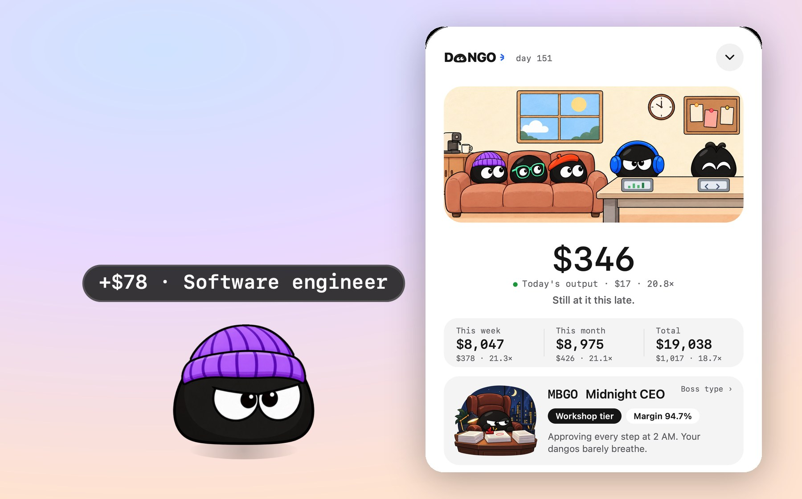
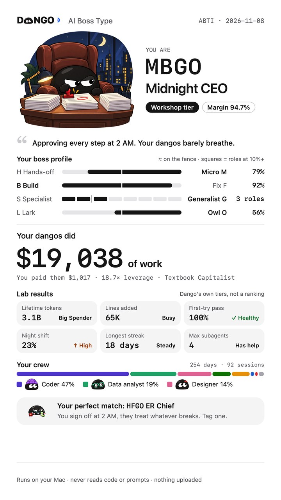
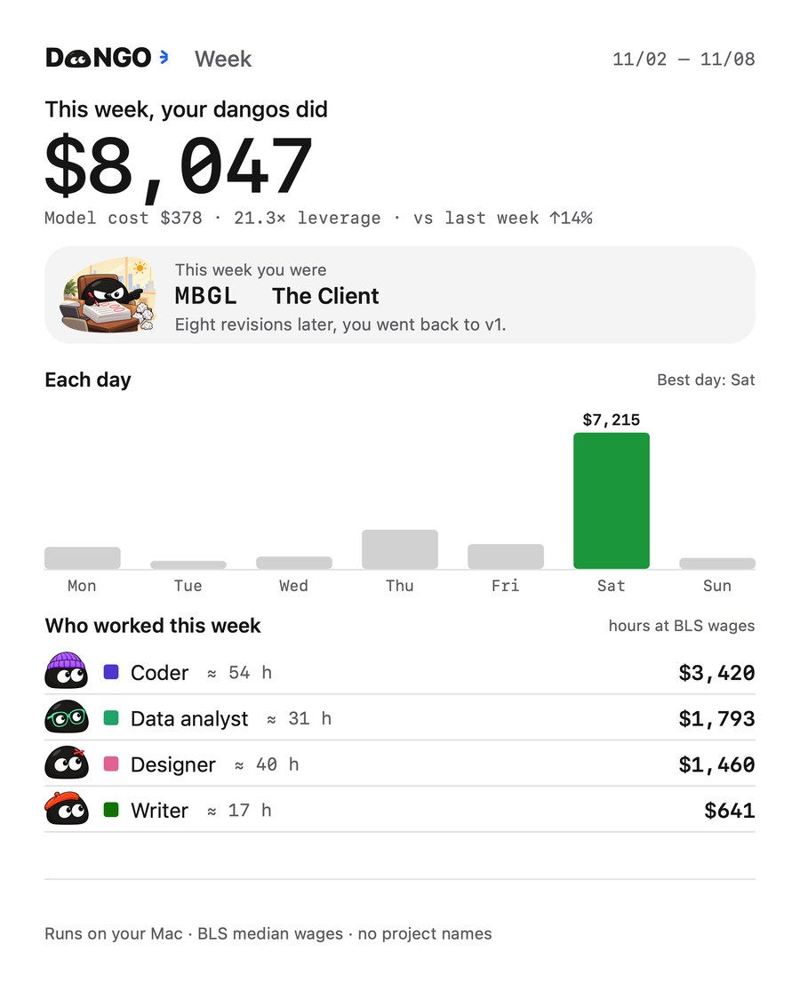

<p align="center">
  <picture>
    <source media="(prefers-color-scheme: dark)" srcset="docs/images/logo-dark.png">
    
  </picture>
</p>

<h3 align="center">Votre IA travaille pour vous. Maintenant, vous le voyez.</h3>

<p align="center">DANGO chiffre chaque étape de votre IA au salaire qu’on paierait à une personne pour faire le même travail.</p>

<p align="center">
  <a href="README.md">中文</a> · <a href="README.en.md">English</a> · <a href="README.ko.md">한국어</a> · <a href="README.ja.md">日本語</a> · <b>Français</b> · <a href="README.es.md">Español</a>
</p>

<p align="center">
  <a href="https://dangoai.org/en/"><b>dangoai.org</b></a> · <a href="#installer">Installer</a> · <a href="https://dangoai.org/en/how/">Le calcul</a> · <a href="docs/DEVELOPMENT.md">Développer</a>
</p>

<p align="center"><sub>Gratuit · macOS 13 ou plus récent · Apple silicon et Intel · tout est calculé sur votre Mac</sub></p>

<p align="center">
  
</p>

## Votre facture dit ce que ça coûte. Pas ce que ça vaut.

Chaque jour, vous confiez du travail à Claude Code, Codex et les autres : du code, des tableaux, du montage vidéo, des recherches. La facture de tokens vous dit combien vous avez dépensé. Rien ne vous dit combien de travail ils ont réellement fait pour vous.

| Facture des modèles | Travail fait par vos dangos | Levier |
| :---: | :---: | :---: |
| **998 $** | **18 588 $** | **18,6×** |
| Des tokens consommés, de l’argent dépensé. | Ce que vous paieriez des gens pour le même travail. | Ce que rapporte en travail chaque dollar de modèle. |

<sub>Données d’exemple. Vos propres chiffres apparaissent dès l’installation.</sub>

## À qui confieriez-vous ce travail ?

À chaque étape de votre IA, DANGO pose une question : qui embaucheriez-vous pour la faire ? Le code va à un **ingénieur logiciel**, les graphiques à un **analyste de données**, le ventre du chat à un **médecin**. Puis il estime le temps qu’il faudrait à une personne et applique le salaire horaire de ce métier.

| Ce que l’IA a fait | Qui embaucher | Temps pour une personne | Salaire |
| --- | --- | --- | ---: |
| Modifié 120 lignes de code | Ingénieur logiciel · 65,38 $/h | environ 23 min | 25,06 $ |
| Lancé un script qui trace un graphique | Analyste de données · 57,80 $/h | 4 min | 3,85 $ |
| Demandé pourquoi le chat a la diarrhée | Médecin · 117,39 $/h | une consultation de 15 min | 29,35 $ |

## 20 métiers, payés au vrai salaire médian américain.

Les salaires horaires viennent du **Bureau of Labor Statistics** des États-Unis (OEWS, mai 2025) : le salaire seul, sans avantages. Sans plafond, sans remise.

<p align="center"></p>

| Métier | Horaire | Métier | Horaire |
| --- | ---: | --- | ---: |
| Médecin | 117,39 $ | Développeur front-end | 47,49 $ |
| Avocat | 76,76 $ | Scientifique | 46,29 $ |
| Ingénieur logiciel | 65,38 $ | Chercheur | 37,87 $ |
| Analyste de données | 57,80 $ | Rédacteur | 36,98 $ |
| Ingénieur QA | 50,14 $ | Monteur vidéo | 36,26 $ |
| Analyste financier | 49,40 $ | Graphiste | 30,27 $ |
| Chef de produit | 49,19 $ | Chef cuisinier | 30,03 $ |
| Musicien | 47,80 $ | Conseiller | 28,53 $ |
| Architecte | 47,73 $ | Coach sportif | 22,67 $ |
| Ingénieur d’exploitation | 47,66 $ | Opérateur de saisie | 19,88 $ |

## Il vit dans un coin de votre écran, habillé pour le travail.

Un bonnet pour le code, un casque pour la vidéo. À la fin de chaque tour, une petite bulle dit ce qu’il a rapporté. **Un clic, et tout le bureau s’ouvre** : qui est à son poste, qui attend votre feu vert, qui flemmarde sur le canapé ou s’est endormi ; ce que valent aujourd’hui, cette semaine, ce mois et le total, avec le coût des modèles et le levier. Le bureau suit l’horloge de votre Mac, du jour au coucher de soleil puis à la nuit, et un thème sombre habille les dangos de blanc.

<p align="center"></p>

## Quatre agents. Un seul bureau.

**Claude Code · Codex · DeepSeek · WorkBuddy**

Aucun plugin, aucun réglage. DANGO lit les journaux de session que ces outils gardent déjà sur votre Mac, compte votre travail passé dès l’installation et les met côte à côte : qui en a fait le plus, qui vous donne le plus de levier.

## Vous êtes le patron. Quel genre de patron ?

Pas de questionnaire. À partir de ce que vos agents ont vraiment fait, DANGO calcule **quatre lettres, une taille d’entreprise et une marge**, puis raconte votre histoire : votre nuit la plus tardive, votre plus grosse journée, votre fiche de paie.

<table>
<tr>
<td width="300"></td>
<td>

| Axe | D’un côté | De l’autre |
| --- | --- | --- |
| Comment vous déléguez | Délègue **H** | Micro-gère **M** |
| Ce que vous faites surtout | Construire **B** | Réparer **F** |
| Votre champ d’action | Spécialiste **S** | Généraliste **G** |
| Quand vous travaillez | Lève-tôt **L** | Oiseau de nuit **O** |

Quatre axes, seize types de patron. La taille de votre entreprise suit le travail de vos dangos, en cinq paliers : Auto-entrepreneur, Atelier, Studio, Groupe, Société cotée.

[Voir les 16 types →](https://dangoai.org/en/types/)

</td>
</tr>
</table>

## Chaque rapport est une carte à partager.

Jour, semaine, mois, année et total, **chacun avec le type de patron de cette période**. Touchez « Partager » et choisissez où l’envoyer. Les cartes ne montrent jamais de noms de projets, de titres de session ni de code.

<p align="center"></p>

## Tout tourne sur votre Mac. Rien n’est envoyé.

- **Que des chiffres** : à quels métiers chaque tour a été attribué, combien de minutes, ce que ça vaut et ce qu’ont coûté les modèles.
- **Aucun contenu conservé** : un prompt est lu une fois en mémoire pour savoir de quoi il parle, puis oublié. Code, chemins et noms de dépôts ne sont jamais enregistrés.
- **Rien d’envoyé** : aucun port réseau ouvert. Partager une carte, c’est vous qui décidez.

## Installer

Le programme d’installation arrive bientôt sur [dangoai.org](https://dangoai.org/en/). En attendant, vous pouvez le construire depuis les sources (Rust et les outils en ligne de commande Xcode sont nécessaires) :

```bash
git clone https://github.com/justinz183/dango.git && cd dango
rustup target add aarch64-apple-darwin x86_64-apple-darwin
apps/widget/package.sh
```

Ouvrez `Dango-<version>.dmg` dans `target/dist`, glissez Dango dans Applications et lancez-le. La première fois, macOS indique qu’il ne peut pas vérifier le développeur : allez dans Réglages Système → Confidentialité et sécurité et cliquez sur « Ouvrir quand même ». Le dango apparaît en bas à droite, lit votre historique pendant quelques secondes, puis raconte l’histoire de votre type de patron. Ensuite, il continue de compter en arrière-plan et revient après un redémarrage.

L’interface de l’app est pour l’instant en chinois et en anglais ; le coréen, le japonais, le français et l’espagnol sont en préparation. Une version Windows est en cours de développement.

## Développer

| Dossier | Contenu |
| --- | --- |
| `crates/core` | Logique pure : sujets, métiers et salaires, calcul |
| `crates/daemon` | Le démon : suit les journaux de chaque agent, SQLite, type de patron, rapports |
| `crates/cli` | La commande `dango` |
| `apps/widget` | L’app macOS (Swift / AppKit) : le dango, le panneau, le bureau, le type de patron, les cartes |
| `assets` | Métiers et salaires, prix des modèles, seuils et textes du type de patron |
| `site` | Le site dangoai.org |

Construire, tester et empaqueter : [docs/DEVELOPMENT.md](docs/DEVELOPMENT.md). Toutes les règles de calcul : [docs/DESIGN.md](docs/DESIGN.md).
