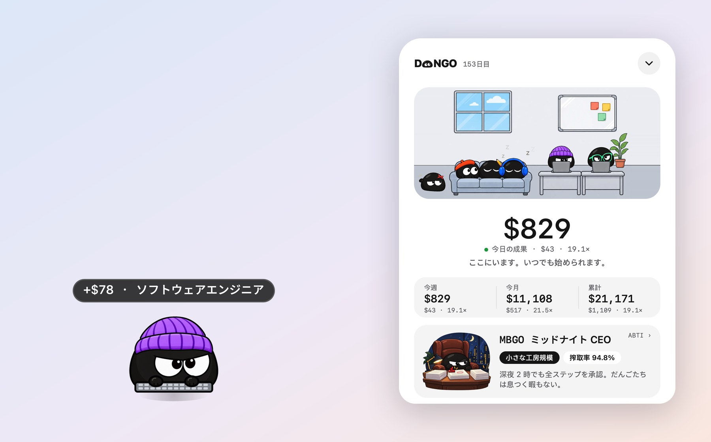
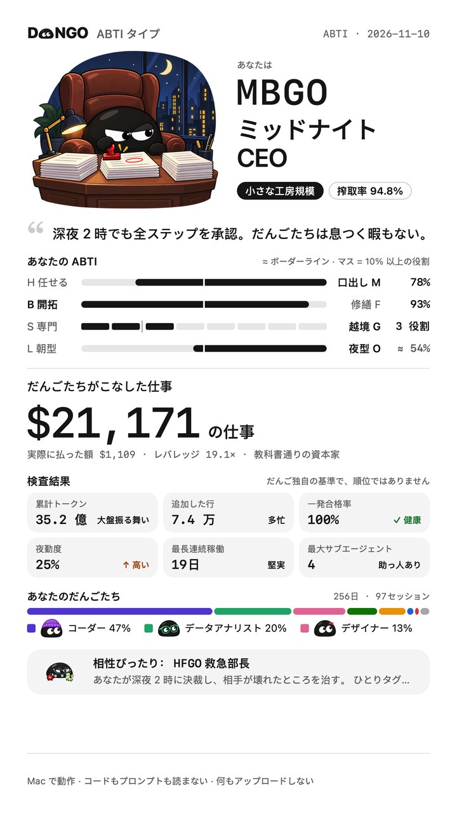
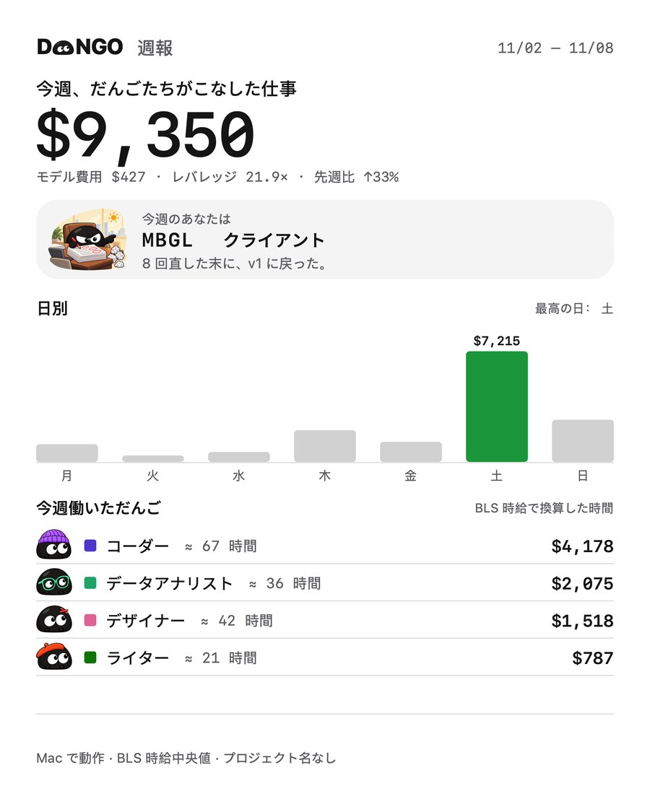

<p align="center">
  <picture>
    <source media="(prefers-color-scheme: dark)" srcset="docs/images/logo-dark.png">
    
  </picture>
</p>

<h3 align="center">あなたの AI は、あなたの代わりに働いています。いま、それが見えます。</h3>

<p align="center">DANGO は、AI がこなす一歩一歩を、同じ仕事を人に頼んだら払う給料に換算します。</p>

<p align="center"><b>DANGO は、Claude Code や Codex などの AI ツールがあなたの代わりにどれだけ働き、いくらかかり、どれだけの価値があったかを集計する無料の Mac メニューバーアプリです。</b></p>

<p align="center">
  <a href="README.md">English</a> · <a href="README.zh.md">中文</a> · <a href="README.ko.md">한국어</a> · <b>日本語</b> · <a href="README.fr.md">Français</a> · <a href="README.es.md">Español</a>
</p>

<p align="center">
  <a href="https://dangoai.org/ja/"><b>dangoai.org</b></a> · <a href="#インストール">インストール</a> · <a href="https://dangoai.org/ai-work-value/">計算のしくみ</a> · <a href="docs/DEVELOPMENT.md">開発</a>
</p>

<p align="center">
  <a href="https://github.com/justinz183/dango/releases/latest"></a>
  
  <a href="https://github.com/justinz183/dango/commits"></a>
</p>

<p align="center"><sub>無料 · macOS 13 以降 · Apple シリコンと Intel · 計算はすべてあなたの Mac の中で</sub></p>

<p align="center">
  
</p>

## 請求書は、いくら使ったかしか教えてくれない。どれだけの価値かは教えてくれない。

毎日、Claude Code や Codex に仕事を任せています。コードの修正、表づくり、動画編集、調べもの。トークンの請求書は使った金額を教えてくれますが、AI が実際にどれだけ働いてくれたのかは、誰も教えてくれません。

| モデルの請求 | だんごがこなした仕事 | レバレッジ |
| :---: | :---: | :---: |
| **$326** | **$4,834** | **14.8×** |
| トークンを使った分だけお金が出ていく。 | 同じ仕事を人に頼んだら払う給料。 | モデルに払った 1 ドルが生んだ仕事の価値。 |

<sub>サンプルデータです。インストールすれば、あなた自身の数字になります。</sub>

## この仕事、誰に頼む？

AI が一歩進むたびに、だんごは問いかけます。この仕事は誰に頼むべき？ コードの修正は**ソフトウェアエンジニア**、グラフは**データアナリスト**、猫の下痢は**医師**。そして人がこの作業にかかる時間を見積もり、その職業の時給で換算します。

| AI がしたこと | 頼む相手 | 人がかかる時間 | 給料 |
| --- | --- | --- | ---: |
| コードを 120 行修正 | ソフトウェアエンジニア · 時給 $65.38 | 約 23 分 | $25.06 |
| グラフを描くスクリプトを実行 | データアナリスト · 時給 $57.80 | 4 分 | $3.85 |
| 質問：猫が下痢をするのはなぜ？ | 医師 · 時給 $117.39 | 診察 1 回 15 分 | $29.35 |

## 20 の職業を、アメリカの実際の時給中央値で。

時給は**米国労働統計局**（BLS OEWS、2025 年 5 月）のデータです。給料だけで、福利厚生は含みません。上限も、割引もありません。

<p align="center"></p>

| 職業 | 時給 | 職業 | 時給 |
| --- | ---: | --- | ---: |
| 医師 | $117.39 | フロントエンドエンジニア | $47.49 |
| 弁護士 | $76.76 | 科学者 | $46.29 |
| ソフトウェアエンジニア | $65.38 | リサーチャー | $37.87 |
| データアナリスト | $57.80 | ライター | $36.98 |
| QA エンジニア | $50.14 | 動画編集者 | $36.26 |
| 金融アナリスト | $49.40 | グラフィックデザイナー | $30.27 |
| プロダクトマネージャー | $49.19 | シェフ | $30.03 |
| ミュージシャン | $47.80 | カウンセラー | $28.53 |
| 建築家 | $47.73 | フィットネストレーナー | $22.67 |
| 運用エンジニア | $47.66 | データ入力係 | $19.88 |

## 画面の隅に住んで、仕事に合わせて着替えます。

コードを書くときはニット帽、動画を編集するときはヘッドホン。1 ターン終わるたびに、今回いくら稼いだかが頭の上にふわっと出ます。**クリックすれば、オフィス全体が開きます。**誰がデスクで働いているか、誰があなたの承認を待っているか、誰がソファでサボって眠っているか。今日、今週、今月、累計の価値と、モデル費用、レバレッジ。オフィスは Mac の時計に合わせて昼、夕焼け、夜と移り変わり、ダークテーマでは白いだんごになります。

<p align="center"></p>

## 4 つの AI を、ひとつのオフィスで。

**Claude Code · Codex · DeepSeek · WorkBuddy**

プラグインも設定も要りません。これらのツールが Mac に残しているセッション記録をそのまま読み、インストールした瞬間に過去の仕事まで計算して、誰がたくさん働いたか、誰のレバレッジが高いかを並べて見せます。

## ABTI：さあ、あなたは社長です。どんな社長？

質問に答える必要はありません。AI が実際にやったことから、あなたの **ABTI**（4 文字のタイプ）と会社の規模、搾取率を割り出し、あなたの物語を語ります。いちばん遅くまで働いた夜、いちばん頑張った一日、そしてあなたの給与明細。

<table>
<tr>
<td width="300"></td>
<td>

| 軸 | 一方 | もう一方 |
| --- | --- | --- |
| 仕事の任せ方 | 任せる **H** | 口出し **M** |
| 主にしていること | 開拓 **B** | 修繕 **F** |
| 仕事の幅 | 専門 **S** | 越境 **G** |
| 働く時間 | 朝型 **L** | 夜型 **O** |

4 つの軸で、ABTI は全 16 タイプ。会社の規模は、だんごがこなした仕事で 5 段階：個人商店、小さな工房、スタジオ、グループ、上場企業。

[ABTI の 16 タイプをすべて見る →](https://dangoai.org/ja/#boss)

</td>
</tr>
</table>

## すべてのレポートが、自慢できるカードに。

日報、週報、月報、年報、累計のそれぞれに、**その期間のあなたの ABTI**がつきます。「共有」を押せばシステムの共有メニューが開きます。カードにプロジェクト名、セッションのタイトル、コードが載ることはありません。

<p align="center"></p>

## 計算はすべて Mac の中で。何もアップロードしません。

- **数字だけを記録**：各ターンがどの職業に割り当てられ、何分で、どれだけの価値で、モデル費用がいくらだったか。
- **内容は残さない**：プロンプトは、何の分野の話かを判断するためにメモリ上で一度読んで捨てます。コード、パス、リポジトリ名は保存しません。
- **アップロードなし**：ネットワークポートを開きません。カードを共有するかどうかはあなた次第です。

## インストール

macOS 13 以降（Apple シリコンと Intel）、または 64 ビット版 Windows 10 1803 以降（プレビュー版）。3 つの方法から選んでください。

### 1. ダウンロード

| | |
| --- | --- |
| **macOS** | [**Dango-macOS.dmg**](https://github.com/justinz183/dango/releases/latest/download/Dango-macOS.dmg) · Dango を「アプリケーション」にドラッグして起動します。まだ公証を受けていないため、初回は macOS が開発元を確認できないと表示します。「システム設定 → プライバシーとセキュリティ」で「このまま開く」を押してください。 |
| **Windows** （プレビュー版） | [**Dango-Windows-x64-setup.exe**](https://github.com/justinz183/dango/releases/latest/download/Dango-Windows-x64-setup.exe) · 実行すると、管理者権限なしで自分だけにインストールされます。まだ署名されていないため、SmartScreen に止められたら「詳細情報 → 実行」を押してください。 |

### 2. AI に頼む

次の文を Claude Code や Codex などの AI コーディングアシスタントに送ってください：

```text
このコンピューターに DANGO（https://github.com/justinz183/dango）をインストールして。
macOS ならターミナルで実行：curl -fsSL https://dangoai.org/install.sh | sh
Windows なら PowerShell で実行：irm https://dangoai.org/install.ps1 | iex
スクリプトが GitHub から最新版をダウンロードし、SHA-256 を確認してアプリを開きます。
終わったら、Dango がどこにインストールされたか、起動しているかを教えて。
```

### 3. コマンドライン

```bash
# macOS (ターミナル)
curl -fsSL https://dangoai.org/install.sh | sh
```

```powershell
# Windows (PowerShell)
irm https://dangoai.org/install.ps1 | iex
```

スクリプトは GitHub から最新の[リリース](https://github.com/justinz183/dango/releases)をダウンロードし、SHA-256 を確認してインストールし、そのまま開きます。もう一度実行すればアップデートです。この方法なら、Gatekeeper や SmartScreen の警告なしで開けます。

### インストールしたら

だんごが画面の右下に現れ、数秒で履歴を読み込んでから、あなたの ABTI の物語を見せてくれます。その後はバックグラウンドで記録を続け、再起動しても戻ってきます。Claude Code や Codex には何もインストールする必要はありません。

アプリの画面は英語、中国語、韓国語、日本語、フランス語、スペイン語に対応しています。だんごを右クリックして言語を選んでください。

**Windows（プレビュー版）** には WebView2 が必要です（Windows 11 は標準搭載）。`%LOCALAPPDATA%\Dango` にインストールされ、トレイアイコンを左クリックするとパネルが開閉し、右クリックで言語と外観を変えられます。バックグラウンドの記録も同じ `Dango.exe` が担当し、ログイン時に起動して、データは `%USERPROFILE%\.dango` に保存されます。このバージョンには隅のだんご、パネル、トレイがあり、ABTI の物語、レポート画面、共有画像は次の段階です。「今日を共有」は当面テキストのレポートをコピーします。

**ソースからパッケージを作る**（Rust と Xcode コマンドラインツールが必要）：`apps/widget/package.sh` が `target/dist` に dmg を作ります。詳しくは [docs/DEVELOPMENT.md](docs/DEVELOPMENT.md)。Windows のインストーラーは [Windows ワークフロー](.github/workflows/windows.yml) が Windows 上でビルドします。

## 開発

| フォルダ | 内容 |
| --- | --- |
| `crates/core` | 純粋なロジック：話題の分類、職業と時給、スコア計算 |
| `crates/daemon` | デーモン：各 AI のセッション記録の追跡、SQLite、ABTI、レポート |
| `crates/cli` | `dango` コマンド |
| `apps/widget` | macOS アプリ（Swift / AppKit）：だんご、パネル、オフィス、ABTI、共有カード |
| `apps/windows` | Windows アプリ（Tauri v2）：だんご、パネル、トレイ。同じ `Dango.exe --daemon` がバックグラウンドで記録 |
| `assets` | 職業と時給、モデル単価、ABTI のしきい値と文言 |
| `site` | ウェブサイト dangoai.org |
| `plugins/claude-code` | 開発用の任意の Claude Code プラグイン（ターンごとの精算ボックス、ステータスライン）。アプリには不要です |

ビルド、テスト、パッケージ：[docs/DEVELOPMENT.md](docs/DEVELOPMENT.md)。計算ルールの全体：[docs/DESIGN.md](docs/DESIGN.md)。

## ライセンス

ソースは、DANGO があなたのデータをどう扱うかを読んで確かめられるように公開していますが、オープンソースではなく、すべての権利を留保します。コードを読むこと、自分でビルドして試すこと、Issue やプルリクエストを送ることはできます。それ以外の利用には事前の許可が必要です。詳しくは [LICENSE](LICENSE) をご覧ください。
