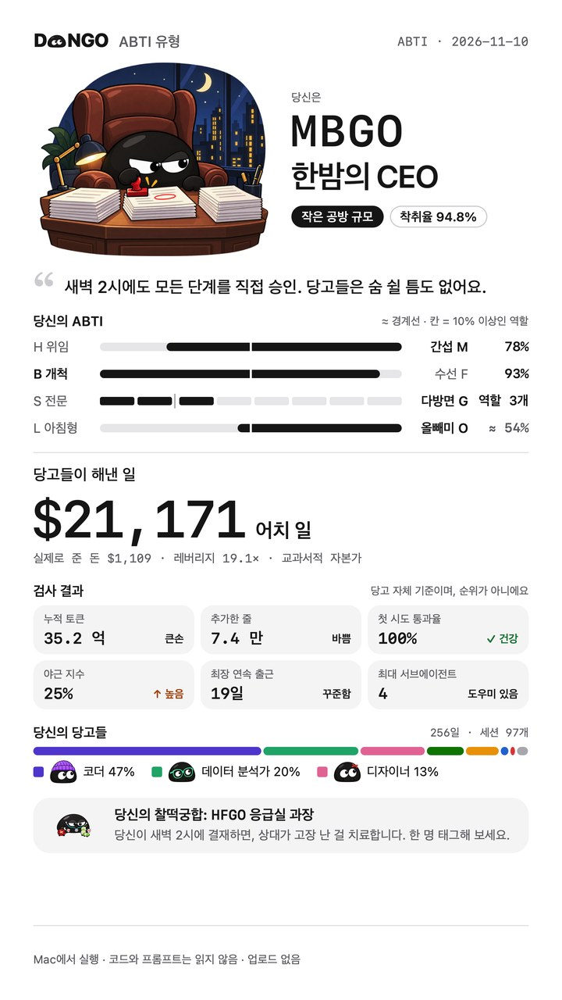
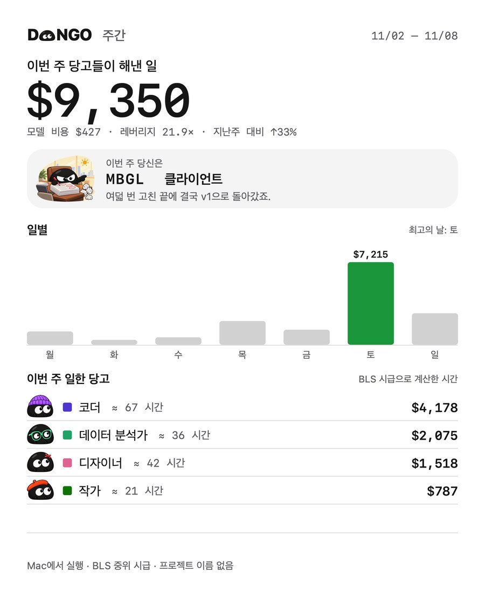

<p align="center">
  <picture>
    <source media="(prefers-color-scheme: dark)" srcset="docs/images/logo-dark.png">
    
  </picture>
</p>

<h3 align="center">당신의 AI가 당신 대신 일하고 있습니다. 이제 그게 보입니다.</h3>

<p align="center">DANGO는 AI가 하는 모든 단계를, 같은 일을 사람에게 맡겼을 때 줘야 할 임금으로 환산합니다.</p>

<p align="center"><b>DANGO는 Claude Code, Codex 등 AI 도구가 나 대신 얼마나 일했는지, 얼마를 썼는지, 그 일이 얼마의 가치인지 집계해 주는 무료 Mac 메뉴 막대 앱이에요.</b></p>

<p align="center">
  <a href="README.md">English</a> · <a href="README.zh.md">中文</a> · <b>한국어</b> · <a href="README.ja.md">日本語</a> · <a href="README.fr.md">Français</a> · <a href="README.es.md">Español</a>
</p>

<p align="center">
  <a href="https://dangoai.org/ko/"><b>dangoai.org</b></a> · <a href="#설치">설치</a> · <a href="https://dangoai.org/ai-work-value/">계산 방법</a> · <a href="docs/DEVELOPMENT.md">개발</a>
</p>

<p align="center">
  <a href="https://github.com/justinz183/dango/releases/latest"></a>
  
  <a href="https://github.com/justinz183/dango/commits"></a>
</p>

<p align="center"><sub>무료 · macOS 13 이상 · Apple 실리콘과 Intel · 모든 계산은 당신의 Mac 안에서</sub></p>

<p align="center">
  
</p>

## 청구서는 얼마를 썼는지만 알려줍니다. 얼마의 가치인지는 알려주지 않죠.

매일 Claude Code, Codex 같은 AI에게 일을 맡깁니다. 코드 수정, 표 만들기, 영상 편집, 자료 조사까지. 토큰 청구서는 얼마를 썼는지 알려주지만, AI가 실제로 얼마만큼의 일을 해줬는지는 아무도 알려주지 않습니다.

| 모델 청구서 | 당고가 해낸 일 | 레버리지 |
| :---: | :---: | :---: |
| **$326** | **$4,834** | **14.8×** |
| 토큰을 쓴 만큼 돈이 나갑니다. | 같은 일을 사람에게 맡기면 줘야 할 임금. | 모델에 쓴 1달러가 해낸 일의 가치. |

<sub>예시 데이터입니다. 설치하면 당신의 숫자가 나옵니다.</sub>

## 이 일, 누구에게 맡겨야 할까?

AI가 한 단계를 할 때마다 당고는 묻습니다. 이 일은 누구에게 맡겨야 할까? 코드 수정은 **소프트웨어 엔지니어**, 차트는 **데이터 분석가**, 고양이 배탈은 **의사**. 그리고 사람이 이 일을 하면 얼마나 걸릴지 추정해, 그 직업의 시급으로 환산합니다.

| AI가 한 일 | 맡길 사람 | 사람이 걸리는 시간 | 임금 |
| --- | --- | --- | ---: |
| 코드 120줄 수정 | 소프트웨어 엔지니어 · 시간당 $65.38 | 약 23분 | $25.06 |
| 차트를 그리는 스크립트 실행 | 데이터 분석가 · 시간당 $57.80 | 4분 | $3.85 |
| 질문: 고양이가 왜 설사를 할까? | 의사 · 시간당 $117.39 | 진료 1회 15분 | $29.35 |

## 20가지 직업, 미국의 실제 중위 시급으로.

시급은 **미국 노동통계국**(BLS OEWS, 2025년 5월) 자료입니다. 임금만 계산하고 복리후생은 넣지 않습니다. 상한도, 할인도 없습니다.

<p align="center"></p>

| 직업 | 시급 | 직업 | 시급 |
| --- | ---: | --- | ---: |
| 의사 | $117.39 | 프론트엔드 엔지니어 | $47.49 |
| 변호사 | $76.76 | 과학자 | $46.29 |
| 소프트웨어 엔지니어 | $65.38 | 리서처 | $37.87 |
| 데이터 분석가 | $57.80 | 작가 | $36.98 |
| QA 엔지니어 | $50.14 | 영상 편집자 | $36.26 |
| 금융 분석가 | $49.40 | 그래픽 디자이너 | $30.27 |
| 프로덕트 매니저 | $49.19 | 셰프 | $30.03 |
| 뮤지션 | $47.80 | 상담사 | $28.53 |
| 건축가 | $47.73 | 피트니스 트레이너 | $22.67 |
| 운영 엔지니어 | $47.66 | 데이터 입력원 | $19.88 |

## 화면 구석에 살면서, 하는 일에 맞춰 옷을 갈아입습니다.

코드를 쓸 땐 비니, 영상을 편집할 땐 헤드폰. 한 턴이 끝나면 머리 위에 이번에 얼마를 벌었는지 떠오릅니다. **한 번 클릭하면 사무실 전체가 열립니다.** 누가 책상에서 일하는지, 누가 당신의 승인을 기다리는지, 누가 소파에서 땡땡이치다 잠들었는지. 오늘, 이번 주, 이번 달, 전체의 가치와 모델 비용, 레버리지까지. 사무실은 Mac의 시계를 따라 낮, 노을, 밤으로 바뀌고, 다크 테마에서는 하얀 당고가 됩니다.

<p align="center"></p>

## AI 넷, 한 사무실.

**Claude Code · Codex · DeepSeek · WorkBuddy**

플러그인도, 설정도 필요 없습니다. 이 도구들이 Mac에 이미 남기는 세션 기록을 그대로 읽어서, 설치하는 순간 지난 일까지 모두 계산하고, 누가 더 많이 했는지, 누구의 레버리지가 더 높은지 나란히 보여줍니다.

## ABTI: 이제 당신이 사장입니다. 어떤 사장인가요?

질문에 답할 필요가 없습니다. AI가 실제로 한 일로 당신의 **ABTI**(알파벳 네 글자)와 회사 규모, 착취율을 계산하고, 당신의 이야기를 들려줍니다. 가장 늦게까지 일한 밤, 가장 치열했던 하루, 그리고 당신의 급여 명세서.

<table>
<tr>
<td width="300"></td>
<td>

| 차원 | 한쪽 | 다른 쪽 |
| --- | --- | --- |
| 일을 맡기는 방식 | 위임 **H** | 간섭 **M** |
| 주로 하는 일 | 개척 **B** | 수선 **F** |
| 일의 범위 | 전문 **S** | 다방면 **G** |
| 일하는 시간 | 아침형 **L** | 올빼미 **O** |

네 가지 차원, 16가지 ABTI 유형. 회사 규모는 당고가 해낸 일에 따라 다섯 단계입니다: 1인 가게, 작은 공방, 스튜디오, 그룹, 상장사.

[ABTI 16가지 유형 모두 보기 →](https://dangoai.org/ko/#boss)

</td>
</tr>
</table>

## 모든 리포트는 자랑할 수 있는 카드입니다.

일간, 주간, 월간, 연간, 전체 리포트마다 **그 기간의 ABTI 유형**이 담깁니다. 「공유」를 누르면 시스템 공유 메뉴가 열립니다. 카드에는 프로젝트 이름과 세션 제목이 절대 들어가지 않습니다.

<p align="center"></p>

## 모든 계산은 Mac 안에서. 아무것도 업로드하지 않습니다.

- **숫자만 기록**: 각 턴이 어떤 직업에게 갔는지, 몇 분인지, 얼마의 가치인지, 모델 비용이 얼마인지.
- **업로드 없음**: 네트워크 포트를 열지 않습니다. 카드를 공유할지는 당신이 정합니다.

## 설치

macOS 13 이상(Apple 실리콘과 Intel) 또는 64비트 Windows 10 1803 이상(프리뷰). 세 가지 방법 중 하나를 고르세요.

### 1. 직접 다운로드

| | |
| --- | --- |
| **macOS** | [**Dango-macOS.dmg**](https://github.com/justinz183/dango/releases/latest/download/Dango-macOS.dmg) · Dango를 「응용 프로그램」으로 끌어다 놓고 실행하세요. 아직 공증을 받지 않아 처음에는 macOS가 개발자를 확인할 수 없다고 알립니다. 「시스템 설정 → 개인정보 보호 및 보안」에서 「그래도 열기」를 누르세요. |
| **Windows** (프리뷰) | [**Dango-Windows-x64-setup.exe**](https://github.com/justinz183/dango/releases/latest/download/Dango-Windows-x64-setup.exe) · 실행하면 관리자 권한 없이 현재 사용자에게만 설치됩니다. 아직 서명되지 않아 SmartScreen이 막으면 「추가 정보 → 실행」을 누르세요. |

### 2. AI에게 맡기기

아래 내용을 Claude Code, Codex 등 AI 코딩 도우미에게 보내세요:

```text
이 컴퓨터에 DANGO(https://github.com/justinz183/dango)를 설치해 줘.
macOS라면 터미널에서 실행: curl -fsSL https://dangoai.org/install.sh | sh
Windows라면 PowerShell에서 실행: irm https://dangoai.org/install.ps1 | iex
스크립트가 GitHub에서 최신 버전을 내려받아 SHA-256을 확인하고 앱을 열어.
끝나면 Dango가 어디에 설치됐는지, 실행 중인지 알려 줘.
```

### 3. 명령줄

```bash
# macOS (터미널)
curl -fsSL https://dangoai.org/install.sh | sh
```

```powershell
# Windows (PowerShell)
irm https://dangoai.org/install.ps1 | iex
```

스크립트는 GitHub의 최신 [릴리스](https://github.com/justinz183/dango/releases)를 내려받아 SHA-256을 확인하고, 설치한 뒤 바로 엽니다. 다시 실행하면 업데이트됩니다. 이렇게 설치하면 Gatekeeper나 SmartScreen 경고 없이 열립니다.

### 설치한 뒤

당고가 화면 오른쪽 아래에 나타나 몇 초 동안 기록을 읽은 뒤, 당신의 ABTI 유형 이야기를 들려줍니다. 그 뒤로는 백그라운드에서 계속 기록하고, 재시동 후에도 돌아옵니다. Claude Code나 Codex에는 아무것도 설치할 필요가 없습니다.

앱 화면은 영어, 중국어, 한국어, 일본어, 프랑스어, 스페인어를 지원합니다. 당고를 우클릭해 언어를 고르세요.

**Windows (프리뷰)**에는 WebView2가 필요합니다(Windows 11에는 기본 포함). `%LOCALAPPDATA%\Dango`에 설치되며, 트레이 아이콘을 왼쪽 클릭하면 패널이 열리고 닫히고, 오른쪽 클릭하면 언어와 모양을 바꿀 수 있습니다. 백그라운드 기록도 같은 `Dango.exe`가 맡고, 로그인 시 자동으로 시작하며, 데이터는 `%USERPROFILE%\.dango`에 있습니다. 이번 버전에는 구석의 당고, 패널, 트레이가 있고, ABTI 유형 이야기, 리포트 창, 공유 이미지는 다음 단계입니다. 「오늘 공유」는 당분간 텍스트 리포트를 복사합니다.

**소스에서 패키징** (Rust와 Xcode 명령줄 도구 필요): `apps/widget/package.sh`가 `target/dist`에 dmg를 만듭니다. 자세한 내용은 [docs/DEVELOPMENT.md](docs/DEVELOPMENT.md). Windows 설치 파일은 [Windows 워크플로](.github/workflows/windows.yml)가 Windows에서 빌드합니다.

## 개발

| 폴더 | 내용 |
| --- | --- |
| `crates/core` | 순수 로직: 주제 분류, 직업과 시급, 점수 계산 |
| `crates/daemon` | 데몬: 각 AI의 세션 기록 추적, SQLite, ABTI 유형, 리포트 |
| `crates/cli` | `dango` 명령 |
| `apps/widget` | macOS 앱(Swift / AppKit): 당고, 패널, 사무실, ABTI 유형, 공유 카드 |
| `apps/windows` | Windows 앱(Tauri v2): 당고, 패널, 트레이. 같은 `Dango.exe --daemon`이 백그라운드에서 기록 |
| `assets` | 직업과 시급, 모델 단가, ABTI 유형의 기준과 문구 |
| `site` | 웹사이트 dangoai.org |
| `plugins/claude-code` | 개발할 때 쓰는 선택 사항인 Claude Code 플러그인(턴이 끝날 때 정산 상자, 상태 표시줄). 앱에는 필요 없어요 |

빌드, 테스트, 패키징: [docs/DEVELOPMENT.md](docs/DEVELOPMENT.md). 전체 계산 규칙: [docs/DESIGN.md](docs/DESIGN.md).

## 라이선스

소스는 DANGO가 내 데이터를 어떻게 다루는지 읽고 확인할 수 있도록 공개되어 있지만, 오픈 소스는 아니며 모든 권리를 보유합니다. 코드를 읽고, 직접 빌드해 써 보고, 이슈나 풀 리퀘스트를 보낼 수 있어요. 그 밖의 용도는 사전 허락이 필요합니다. 자세한 내용은 [LICENSE](LICENSE)를 보세요.
