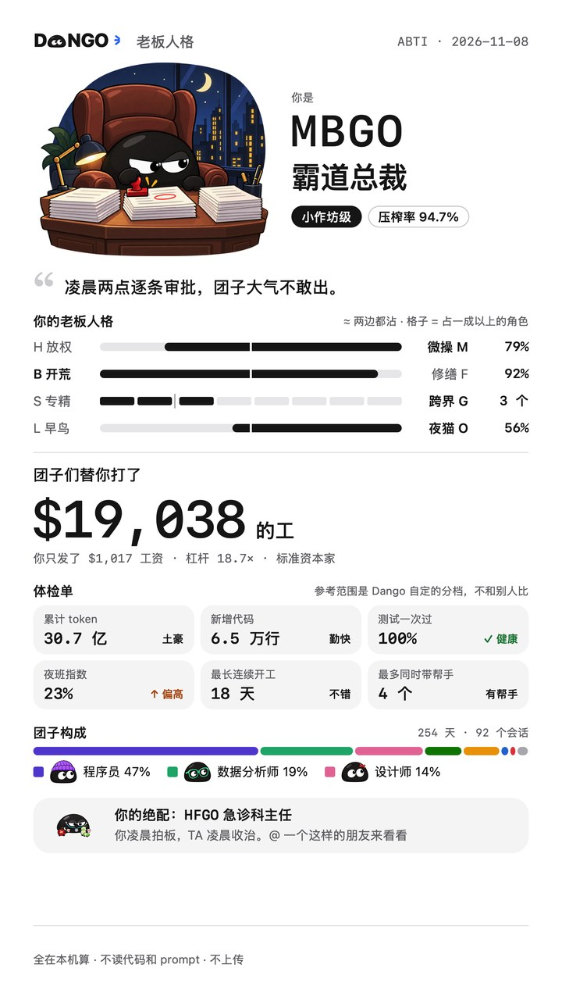
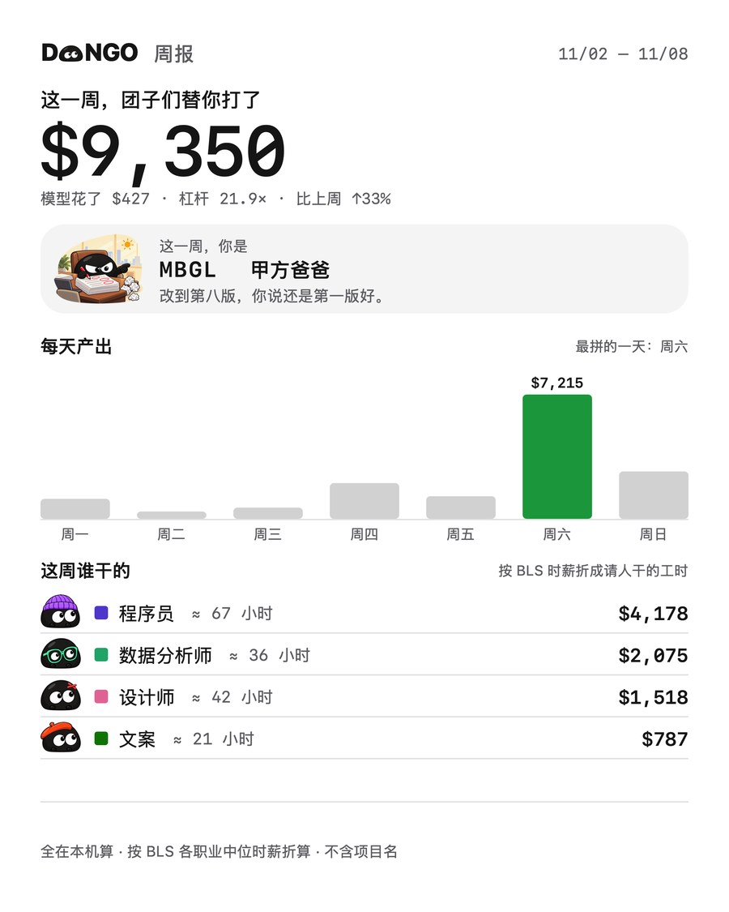

<p align="center">
  <picture>
    <source media="(prefers-color-scheme: dark)" srcset="docs/images/logo-dark.png">
    
  </picture>
</p>

<h3 align="center">你的 AI 在替你打工。现在，你看得见了。</h3>

<p align="center">打工团子 DANGO 把 AI 干的每一步，换算成一个真人要拿的工钱。</p>

<p align="center">
  <b>中文</b> · <a href="README.en.md">English</a> · <a href="README.ko.md">한국어</a> · <a href="README.ja.md">日本語</a> · <a href="README.fr.md">Français</a> · <a href="README.es.md">Español</a>
</p>

<p align="center">
  <a href="https://dangoai.org"><b>官网 dangoai.org</b></a> · <a href="#安装">安装</a> · <a href="https://dangoai.org/how/">怎么算的</a> · <a href="docs/DEVELOPMENT.md">开发</a>
</p>

<p align="center"><sub>免费 · macOS 13 起 · Apple 芯片和 Intel · 全在你的 Mac 上算</sub></p>

<p align="center">
  
</p>

## 账单只告诉你花了多少，没告诉你值多少。

你每天把活交给 Claude Code、Codex 这些 AI：改代码、做表、剪视频、查资料。token 账单告诉你花了多少钱，却没人告诉你，它们到底替你干了多少活。

| 模型账单 | 团子替你打的工 | 杠杆 |
| :---: | :---: | :---: |
| **$998** | **$18,588** | **18.6×** |
| token 用了多少，就扣多少钱。 | 同样的活，请人来干要付的工钱。 | 每花 1 美元模型钱，换回的活值多少。 |

<sub>示例数据。装上就是你自己的数字。</sub>

## 这活，该请谁来干？

AI 每做一步，团子就问一句：这一步该请谁来干？改代码归**软件工程师**，跑图表归**数据分析师**，问猫的病归**医生**。再估一个真人干这一步要多久，按这个职业的时薪折成工钱。

| AI 做了什么 | 请谁来干 | 一个人要多久 | 工钱 |
| --- | --- | --- | ---: |
| 改了 120 行代码 | 软件工程师 · $65.38/时 | 约 23 分钟 | $25.06 |
| 跑了一个出图表的脚本 | 数据分析师 · $57.80/时 | 4 分钟 | $3.85 |
| 问：猫为什么拉肚子？ | 医生 · $117.39/时 | 一次问诊 15 分钟 | $29.35 |

## 20 种职业，按美国真实中位时薪算。

时薪来自**美国劳工统计局**（BLS OEWS，2025 年 5 月），只算工资、不含福利。不封顶，也不打折。

<p align="center"></p>

| 职业 | 时薪 | 职业 | 时薪 |
| --- | ---: | --- | ---: |
| 医生 | $117.39 | 前端工程师 | $47.49 |
| 律师 | $76.76 | 科学家 | $46.29 |
| 软件工程师 | $65.38 | 研究员 | $37.87 |
| 数据分析师 | $57.80 | 文案 | $36.98 |
| 测试工程师 | $50.14 | 视频剪辑 | $36.26 |
| 金融分析师 | $49.40 | 平面设计 | $30.27 |
| 产品经理 | $49.19 | 厨师 | $30.03 |
| 音乐人 | $47.80 | 心理咨询师 | $28.53 |
| 建筑师 | $47.73 | 健身教练 | $22.67 |
| 运维工程师 | $47.66 | 资料录入 | $19.88 |

## 它住在你屏幕的角落，按手上的活换装。

写代码时戴毛线帽，剪视频时戴耳机。干完一个回合，头顶冒一句这回合挣了多少。**点一下，整间办公室就打开了**：谁在工位上干活，谁在等你批准，谁在沙发上摸鱼、睡着了；今天、本周、本月和总计的产出，各带模型花费和杠杆。办公室跟着你电脑的时间走，白天、晚霞、夜里各不一样；也有深色主题，团子换成白色的。

<p align="center"></p>

## 四个 AI，一起算。

**Claude Code · Codex · DeepSeek · WorkBuddy**

不用装插件，不用改设置。团子直接读这些工具自己写在你电脑上的会话记录，装上就把以前的活也算一遍，面板上并排比谁干得多、谁杠杆高。

## 现在你是老板了。你是哪种老板？

不用答题。按你的 AI 真干了什么，算出**四个字母、公司规模和压榨率**，再讲一遍你的故事：最晚的一夜、最拼的一天、你的工资单。

<table>
<tr>
<td width="300"></td>
<td>

| 维度 | 一边 | 另一边 |
| --- | --- | --- |
| 你怎么派活 | 放权 **H** | 微操 **M** |
| 你多半在干 | 开荒 **B** | 修缮 **F** |
| 你干活的范围 | 专精 **S** | 跨界 **G** |
| 你几点干活 | 早鸟 **L** | 夜猫 **O** |

四个维度，十六型老板。公司规模按团子替你打的工分五档：个体户、小作坊、工作室、集团、上市公司。

[看全部 16 型 →](https://dangoai.org/types/)

</td>
</tr>
</table>

## 每一份报告，都是一张能晒的卡。

日报、周报、月报、年报和总报，**各带那段时间你自己的老板人格**。点「分享」就弹出系统分享菜单。卡上从来没有项目名、会话标题和代码。

<p align="center"></p>

## 全在你的 Mac 上算。什么都不上传。

- **只记数字**：每个回合归给哪些职业、多少分钟、值多少钱、模型花了多少。
- **内容不落地**：prompt 只在内存里看一眼，判断你在聊哪一行，读完就丢。代码、路径、仓库名都不存。
- **什么都不上传**：不开网络端口。分享卡发不发由你。

## 安装

安装包很快会放到 [dangoai.org](https://dangoai.org)。现在可以从源码打包（需要 Rust 和 Xcode 命令行工具）：

```bash
git clone https://github.com/justinz183/dango.git && cd dango
rustup target add aarch64-apple-darwin x86_64-apple-darwin
apps/widget/package.sh
```

打开 `target/dist` 里的 `Dango-<版本>.dmg`，把 Dango 拖进「应用程序」再打开。第一次打开时 macOS 会提示无法验证开发者，去「系统设置 → 隐私与安全性」点「仍要打开」。团子会出现在屏幕右下角，先花几秒读一遍你的历史，然后放一段你的老板人格故事。之后它在后台一直记着，开机也会自己回来。

App 界面有中文、English、한국어、日本語、Français、Español 六种语言，右键「语言」切换。

**Windows（预览版）**：64 位 Windows 10 1803 或更新，要有 WebView2（Windows 11 自带）。运行 `Dango_<版本>_x64-setup.exe`，只装给你自己、不用管理员权限，装在 `%LOCALAPPDATA%\Dango`；安装包还没签名，SmartScreen 拦的时候点「更多信息 → 仍要运行」。团子在屏幕右下角，托盘图标左键开关面板、右键换语言和外观；后台记录的也是 `Dango.exe`，开机自己启动，数据在 `%USERPROFILE%\.dango`。这一版先有角落的团子、面板和托盘，老板人格的故事、报告窗口和分享图下一步做，「分享日报」先复制一份文字日报。安装包由 [Windows 工作流](.github/workflows/windows.yml) 在 Windows 上构建，步骤见 [CLAUDE.md](CLAUDE.md) 的「Windows 版」。

## 开发

| 目录 | 内容 |
| --- | --- |
| `crates/core` | 纯逻辑：话题分类、职业归类与时薪、计分 |
| `crates/daemon` | 守护进程：跟读各个 AI 的会话记录、SQLite、老板人格、报告 |
| `crates/cli` | 命令行 `dango` |
| `apps/widget` | macOS App（Swift / AppKit）：团子、面板、办公室、老板人格、分享图 |
| `apps/windows` | Windows App（Tauri v2）：团子、面板、托盘；同一个 `Dango.exe --daemon` 在后台记录 |
| `assets` | 职业表和时薪、模型单价、老板人格的门槛和文案 |
| `site` | 官网 dangoai.org |

构建、测试和打包看 [docs/DEVELOPMENT.md](docs/DEVELOPMENT.md)，完整的计算规则看 [docs/DESIGN.md](docs/DESIGN.md)。
