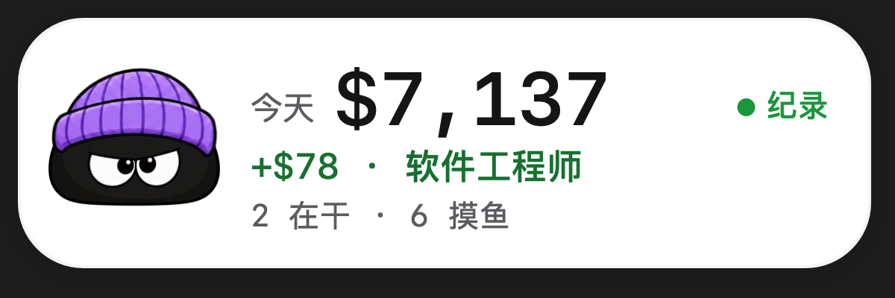
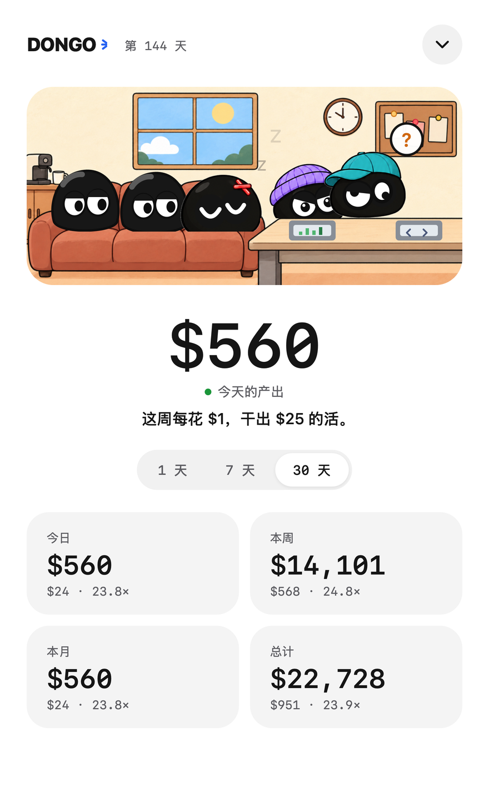
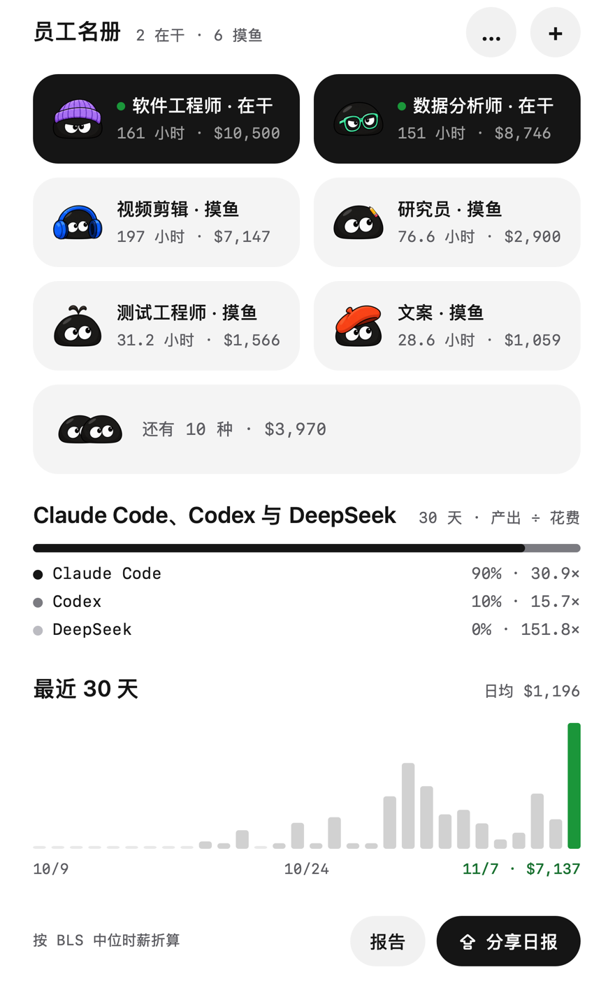
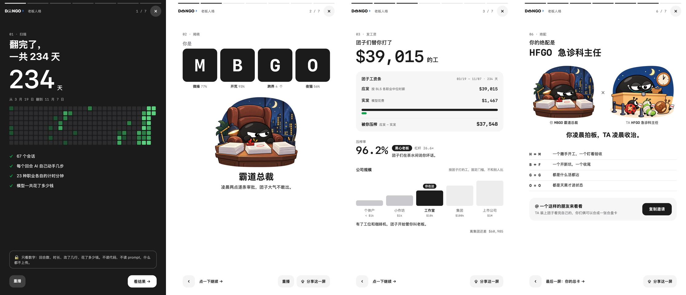
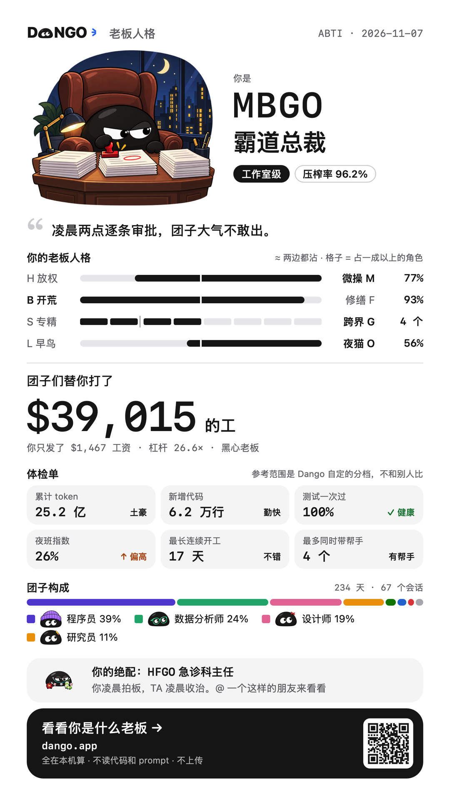
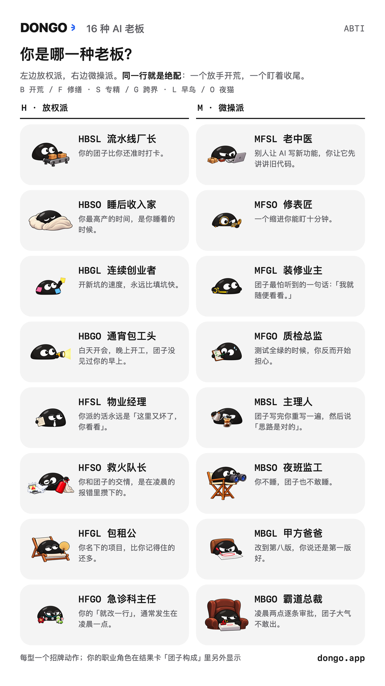
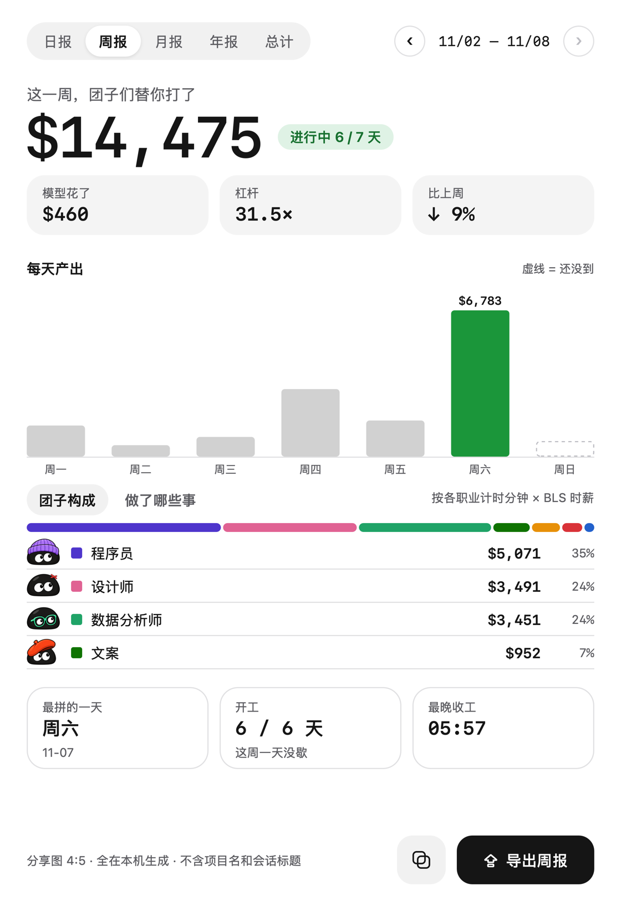
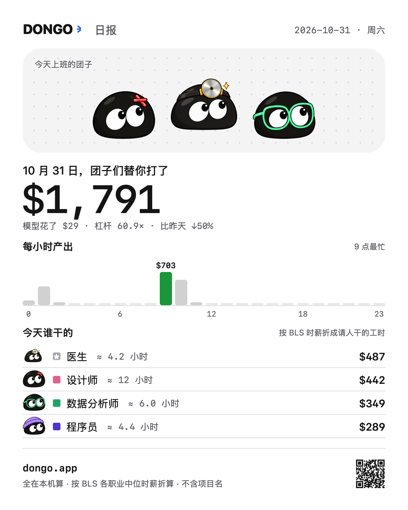

<p align="center">
  
</p>

<h1 align="center">打工团子 DONGO</h1>

<p align="center">
  <b>你的 AI 在替你打工。团子把它干的活折成工钱，摆在你的桌面上。</b><br>
  macOS 桌面小宠物 · Claude Code 和 Codex · 全部在本机算 · 中文 / English
</p>

---

## 一个新的算法

每天你把活交给 Claude Code 和 Codex：改代码、做表、剪视频、查资料、写方案。它们到底替你干了多少？token 数和账单回答不了这个问题。

团子换了个算法：把 AI 当成一群员工。AI 每做一步，团子就问一句「这活该请谁来干」：改代码请软件工程师，修图请设计师，查文献请研究员，问猫为什么拉肚子请医生。它估一个人干这一步要多久，再按美国劳工统计局公布的这个职业的中位时薪，折成一笔工钱。

于是你看到的不再是 token，而是一间办公室：一群团子穿着各自职业的衣服替你干活，下面一行数字告诉你，今天它们干了 $1,791 的活，模型只花了你 $29，杠杆 60 倍。

你成了一家公司的老板。团子还会告诉你，你是哪一种老板。

## 能做什么

### 屏幕角落的团子

一只圆滚滚的黑芝麻团子住在屏幕右下角的一张小卡片上，旁边写着今天干了多少钱的活。AI 干的是什么活，它就换什么装：程序员戴毛线帽，数据分析师戴绿框眼镜，视频剪辑戴耳机。一个回合干完，冒出一行「+$78 · 软件工程师」，也可以顺手发一条系统通知（右键打开）；破了单日纪录当场庆祝。可以拖到任何地方。

### 一间办公室

单击团子，展开成一块面板。

- **办公室**：这周干过活的职业各有一只团子。正在干活的坐在工位上；测试连挂三次的冒烟；没活的在茶水间沙发上摸鱼，久了睡着；Claude Code 弹出权限确认时，那只团子会站到隔断旁，头顶冒问号。
- **今天的产出**：今天干了多少钱的活，破没破纪录，团子再说一句话。
- **四个数字**：今日、本周、本月、总计，每个都带着模型花费和杠杆。
- **员工名册**：每个职业干了多少小时、值多少钱，现在是什么状态。
- **Claude Code 与 Codex**：两边各占多少、各自的杠杆。
- **最近 30 天**：每天一根柱子，今天是绿色的。

右键可以在插画办公室和矢量办公室之间换，也可以切语言。

<p>
  
  
</p>

### 老板人格测试

团子第一次读完你的历史，会打开一段八屏的故事：先猜猜自己是什么样的老板，再看团子们翻你的历史、揭晓答案、给你发工资条、回放名场面（最晚的一夜、最拼的一天）、出一张体检单，最后介绍你的绝配。



四个维度，十六型老板：

| 维度 | 一边 | 另一边 |
| --- | --- | --- |
| 你怎么派活 | 放权 H：派完就撒手 | 微操 M：每一步都要过目 |
| 你多半在干 | 开荒 B：总在开新项目 | 修缮 F：总在修老代码 |
| 你干活的范围 | 专精 S：只干一类活 | 跨界 G：什么活都沾一点 |
| 你几点干活 | 早鸟 L：白天把活干完 | 夜猫 O：天黑才进状态 |

结果是一张能直接发出去的总卡：你的类型和一句吐槽，公司规模（个体户、小作坊、工作室、集团、上市公司），压榨率（团子打的工里，你没付的那部分），你的团子都是谁，还有体检单和绝配。

<p>
  
  
</p>

### 报告和分享图

右键「报告」，或者点面板导出键左边的方块，打开报告窗口：日报、周报、月报、年报和总计。前四种都和上一期比，也能往回翻到过去任何一期。柱图下面可以在「团子构成」和「做了哪些事」之间切换，后者列出这段时间的会话和项目，只在你自己的电脑上显示。

每一页都能导出一张 4:5 的分享图，存到 `~/Pictures/DONGO`，同时复制到剪贴板。分享图上从来不带项目名和会话标题。

<p>
  
  
</p>

### Claude Code 和 Codex 一起算

两个工具按同一套规则记，面板上并排比。不用在 Claude Code 或 Codex 里装任何东西，也不用点任何「信任」：团子直接读它们自己写在电脑上的会话记录。

### 中文和英文

右键「语言 / Language」切换。中文界面全是中文，英文界面全是英文，故事、总卡、报告和分享图都跟着换。

## 一笔工钱是怎么算出来的

1. **每一步归给一个职业**，并估一个人要干多久：改代码按行数算给软件工程师，写文档按字数算给文案，跑测试算给测试工程师，搜索和读网页算给研究员。你在聊什么话题也算数，聊养生的那段研究归医生，聊股票的归金融分析师。一共 23 种职业：软件工程师、前端工程师、测试工程师、运维工程师、数据分析师、医生、健身教练、心理咨询师、金融分析师、文案、产品经理、视频剪辑、平面设计、音乐人、厨师、数学家、物理学家、化学家、生物学家、建筑师、律师、研究员、资料录入。
2. **工钱 = 分钟数 × 这个职业的时薪**。时薪是美国劳工统计局公布的各职业中位时薪，只算工资，不含福利。
3. **杠杆 = 工钱 ÷ 模型花费**。模型花费按每个回合实际用掉的 token 和官方 API 价格算。
4. **不封顶，只增不减**：几个 agent 同时干，每一分钟都算；历史总数不会因为算法更新变少。

完整规则在 [docs/DESIGN.md](docs/DESIGN.md)。

## 隐私

- 全部在你的 Mac 上算，什么都不上传，也不开网络端口。
- 读的是你电脑上 Claude Code 和 Codex 的会话记录（`~/.claude`、`~/.codex`）。prompt 只在内存里看一眼，判断你在聊哪一行的事，读完就丢。
- 存下来的只有数字：每个回合归给了哪些职业、多少分钟、值多少钱、多少 token、花了多少钱、改了几行。外加会话标题和项目文件夹名，只给报告窗口用。
- 分享图和总卡上不出现项目名、会话标题、路径和代码。

## 安装

需要 macOS 13 或更新的系统，Apple 芯片和 Intel 都可以。

在「终端」里运行（下载地址还没上线，上线后就能用）：

```bash
curl -fsSL https://dongo.app/install.sh | sh
```

它会下载 Dango、核对校验值、放进「应用程序」并打开；再运行一次就是更新。用这种方式装，macOS 不会弹「无法验证开发者」。团子出现在屏幕右下角，先花几秒读一遍你的历史，然后自动打开老板人格测试。之后它在后台一直记着，开机也会自己回来；macOS 会提示一次「已添加后台项目」，这是它在后台记录用的。

也可以用 dmg：打开 `Dango-<版本>.dmg`，把 Dango 拖进「应用程序」，然后打开。第一次打开时 macOS 会提示无法验证开发者，去「系统设置 → 隐私与安全性」点「仍要打开」，再打开一次。

想自己打包 dmg，或者参与开发，看 [docs/DEVELOPMENT.md](docs/DEVELOPMENT.md)。
